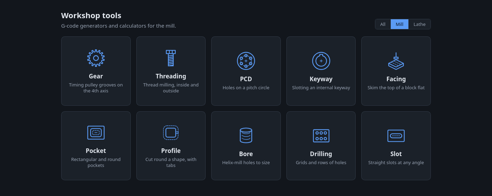
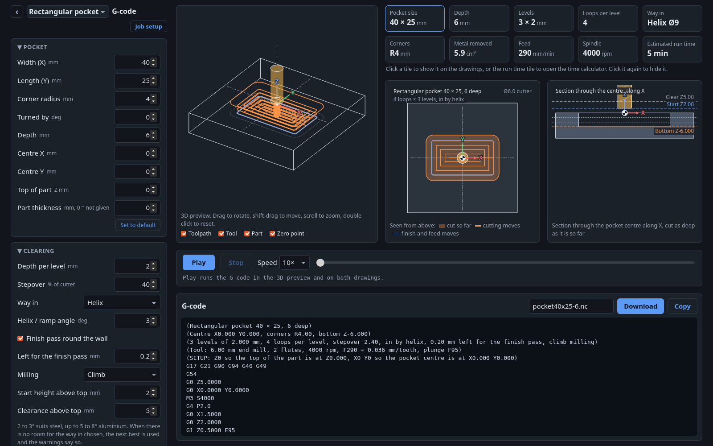
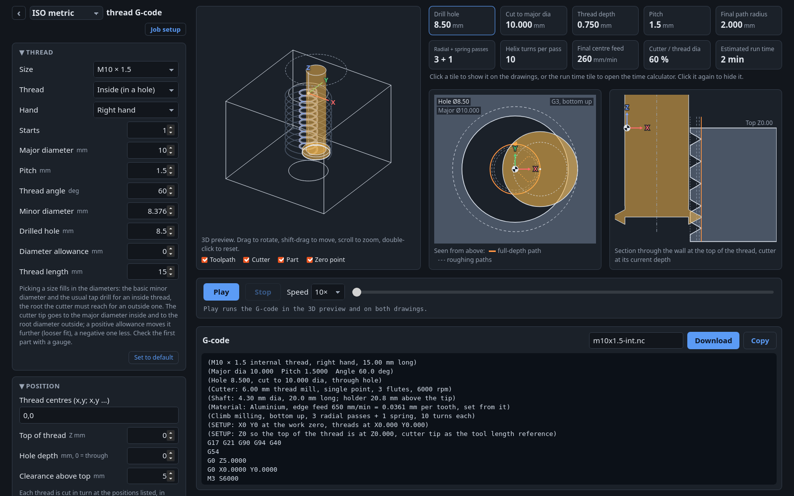
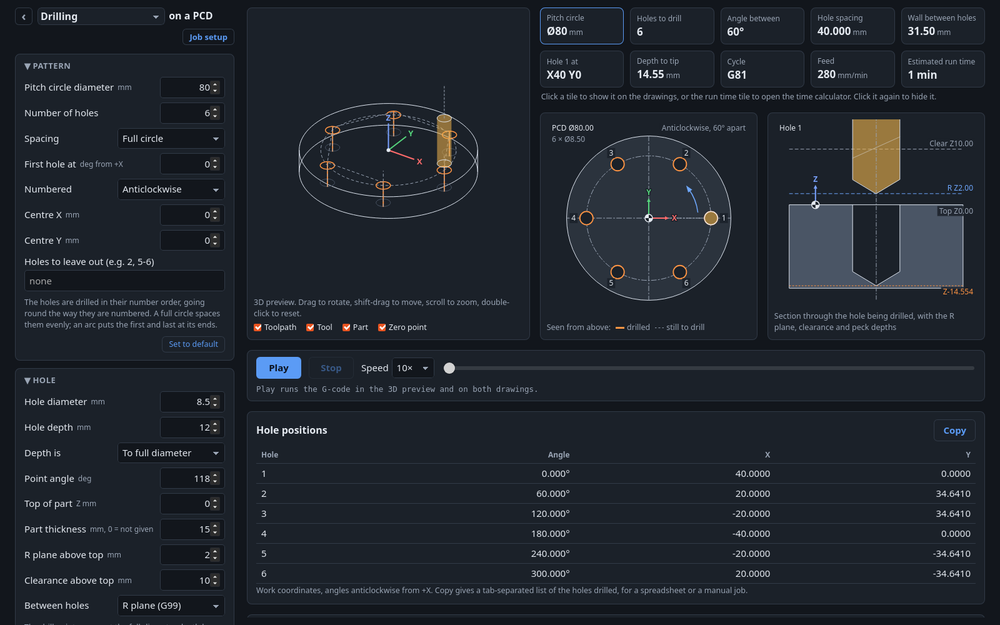

# Workshop

Configuration and tools for a LinuxCNC 4-axis mill. The repo has two parts:

| Folder | What it is |
| --- | --- |
| [`linuxcnc/mill/`](linuxcnc/mill/) | The LinuxCNC 2.10 machine config for the mill (Mesa 5I25 + 7I76, XYZ + A axis), with probing macros, a Probe Screen tab, a dark AXIS theme and an embedded **Tools** tab |
| [`webtools/`](webtools/) | A React + Vite web app of G-code generators (gear, threading, PCD, keyway, facing, pocket, profile, bore, drilling, slot). It runs in any browser, and inside AXIS it can send programs straight to LinuxCNC and run them |



---

## Features

### Web tools (G-code generators)

Each tool is its own page, reached from a landing page of tiles.

| Tool | Does |
| --- | --- |
| **Gear** | Timing-pulley grooves (HTD 5M and similar) cut on the 4th (A) axis |
| **Threading** | Thread milling, inside and outside |
| **PCD** | Holes on a pitch circle |
| **Keyway** | Slotting an internal keyway |
| **Facing** | Skimming the top of a block flat |
| **Pocket** | Rectangular and round pockets |
| **Profile** | Cutting round a shape, with holding tabs |
| **Bore** | Helix-milling holes to size |
| **Drilling** | Grids and rows of holes |
| **Slot** | Straight slots at any angle |

Every tool page has:

- **A settings column**: part size, tool, feeds and speeds, depths. Some feeds are worked out from the material for you.
- **Summary tiles**: passes, cutting time and so on. The time tile opens a **time calculator**.
- **A 3D preview** of the toolpath, the cutter, the part and the work zero, each of which can be shown or hidden, with **playback**.
- **Top and section drawings** of the part.
- **Warnings** when the settings don't make sense, such as a cutter too big for the pocket.
- **The G-code**, ready to copy or download.
- **A job setup dialog** that explains how to hold the part and where to set the zero.
- **Remembered settings.** Each page keeps what you last entered in browser storage.

**Pocket**: settings, summary tiles, 3D preview, top and section drawings, playback and G-code.



**Threading**: an M10 × 1.5 internal thread, with the helix in the 3D preview.



**PCD**: six holes on an 80 mm pitch circle, with the hole-position table.



**Machine-aware.** Pages show only the tools that suit the machine. Inside AXIS the machine kind (mill or lathe) and its axes come from the LinuxCNC INI, so Gear only appears when there is an A axis. In a normal browser you pick All / Mill / Lathe on the landing page, or add `?machine=mill|lathe|all` to the URL.

### LinuxCNC link (AXIS Tools tab)

Opened inside the AXIS **Tools** tab, the pages also get:

- **Send to LinuxCNC**: writes the program to `PROGRAM_PREFIX` (`~/NC`) and opens it in AXIS.
- **Cycle start / Pause / Resume / Stop** from the page or the toolbar.
- **Live status**: machine state, DRO and run progress, about 10 times a second.
- **Machine follow**: the 3D preview tracks the real machine position while a program runs.

The bridge is [`linuxcnc/mill/python/web_tab.py`](linuxcnc/mill/python/web_tab.py), a GTK/WebKit2 window that AXIS embeds. Only pages from the same origin as the tab's URL can talk to LinuxCNC.

### Mill config

- LinuxCNC **2.10** config, converted by hand from the original 2.7 PNCconf config. The original is kept in [`2.7-original/`](linuxcnc/mill/2.7-original/).
- Mesa **5I25 + 7I76** stepgen setup for X, Y, Z and A, plus a PID-controlled spindle.
- **Probe Screen** tab (GladeVCP) for edge, corner, hole and tool-length probing.
- **Probing and touch-off macros** in [`macros/`](linuxcnc/mill/macros/). They are wired to PyVCP panel buttons and keypad keys through HALUI MDI commands:

  | Macro | Button / key | Does |
  | --- | --- | --- |
  | `o100` | TouchOff Probe Pad | Probe Z on the touch pad |
  | `o101` | G0 X0 Y0 | Lift to the top of Z, then go to X0 Y0 |
  | `o102` | TouchPad Location | Record the touch-pad location |
  | `o103` | Tool TouchOff | Measure the tool length on the tool setter |
  | `o105` / `o106` | G0 X0 Y0 Z5 / Z0 | Go to the work zero |
  | `o107` | keypad | Home Z (G28) |
  | `o109` / `o110` | keypad | Spindle on at 4000 rpm / off |
  | `o111` | automatic | Select G54 once **all** joints are homed |

  Probe macros refuse to run unless the probe (tool 0) is loaded. After contact they back off slowly, and they abort if the probe never triggers.
- **Manual tool change** with automatic tool-length measurement: `M6` is remapped to [`manual_change.ngc`](linuxcnc/mill/macros/manual_change.ngc). The tool-setter position is set in `[TOOLSENSOR]` in `Mill.ini`.
- **Dark theme** for AXIS ([`axisrc.py`](linuxcnc/mill/axisrc.py)), the Probe Screen and the Tools toolbar, using the same colours as the web tools.

---

## Install

The setup below is the one this repo is used on: **Ubuntu 26.04** with a realtime kernel, **LinuxCNC 2.10 (uspace)**, **Apache 2.4** and **Node.js 22**. You need Node only to change the web tools, because the built `webtools/dist/` is committed.

### 1. System packages

```bash
sudo apt install linuxcnc-uspace apache2 git \
     python3-gi gir1.2-gtk-3.0 gir1.2-webkit2-4.1
# only needed to develop or rebuild the web tools:
sudo apt install nodejs npm
```

`gir1.2-webkit2-4.1` is the WebKit engine the AXIS Tools tab runs on.

### 2. Get the repo

The config expects the repo at `~/workshop`:

```bash
git clone <repo-url> ~/workshop
```

### 3. Serve the web tools with Apache

The Tools tab loads `http://localhost/workshop/webtools/dist/`. Link the repo into Apache's web root, and let Apache's user into your home folder:

```bash
sudo ln -s ~/workshop /var/www/html/workshop
setfacl -m u:www-data:x ~          # www-data may pass through your home, nothing more
```

Check that it works by opening <http://localhost/workshop/webtools/dist/> in a browser. You should see the tool tiles.

> The site needs `Options FollowSymLinks`, which is on by default in Ubuntu's `000-default` site. If you get a 403, check that each folder on the path to `~/workshop` is executable for `www-data`.

### 4. Set up the LinuxCNC config

Point LinuxCNC at the config in the repo. Either start it directly:

```bash
linuxcnc ~/workshop/linuxcnc/mill/Mill.ini
```

or link it into `~/linuxcnc/configs` so it shows up in the config picker:

```bash
mkdir -p ~/linuxcnc/configs
ln -s ~/workshop/linuxcnc/mill ~/linuxcnc/configs/Mill
```

Then create the program folder, which `PROGRAM_PREFIX` points at and where **Send to LinuxCNC** writes:

```bash
mkdir -p ~/NC
```

> `Mill.ini` has `PROGRAM_PREFIX = /home/hoffmam/NC`. If your user name is different, change it, along with any other absolute paths you find with `grep -n /home Mill.ini`.

### 5. Check the hardware settings

Before moving the machine, check the values in `Mill.ini` and the HAL files against your own machine. They are tuned for this one:

- `[JOINT_n]` `STEP_SCALE`, limits, velocities, accelerations and homing
- `[TOOLSENSOR]` tool-setter `X`, `Y`, `Z` and `MAXPROBE`
- The Mesa firmware and pin assignments in `Mill.hal` and `custom.hal`

---

## Usage

### On the machine

1. Start LinuxCNC with `Mill.ini`, release E-stop, turn the machine on and home all axes. G54 is selected automatically once homing finishes.
2. Open the **Tools** tab in AXIS and pick a tool.
3. Enter the job, check the preview and warnings, then press **Send to LinuxCNC**. The program is saved to `~/NC` and opened in AXIS.
4. Press **Cycle start** in the page toolbar or in AXIS. Use **Pause** and **Stop** as needed. The preview follows the machine while it runs.

### In a browser (no machine)

Open <http://localhost/workshop/webtools/dist/> (or the dev server below). Everything works except the LinuxCNC buttons. Copy or download the G-code instead.

---

## Developing the web tools

```bash
cd ~/workshop/webtools
npm install
npm run dev        # http://localhost:5173/ with live reload
npm run build      # writes dist/, which Apache and the AXIS tab serve
npm run preview    # serve the built dist/ locally
```

- **VS Code:** press **Ctrl+F5** to start the Vite dev server (or reuse a running one) and open the landing page in Chrome. See `.vscode/launch.json` and `tasks.json`.
- **Try the LinuxCNC link without a machine:** under `npm run dev`, add `?mock-linuxcnc` to any page, for example <http://localhost:5173/gear/?mock-linuxcnc>. A fake machine that is on and homed runs sent programs, and the AXIS toolbar is drawn along the bottom of the page. The mock is never included in the build.
- **After changing anything, run `npm run build` and commit `dist/`.** The machine serves the built files, not the sources.

### Layout

```
webtools/
  index.html, <tool>/index.html   one HTML entry per page
  vite.config.js                  lists every page as a build input
  src/
    tools.js                      landing-page tiles: title, icon, which machines
    home/                         landing page
    tools/<tool>/                 one folder per tool: App.jsx + lib/ (the G-code generator)
    shared/
      toolpath/                   shared tool page: settings, 3D view, drawings, playback
      linuxcnc/                   bridge to web_tab.py, machine state, hooks, dev mock
      components/                 tiles, fields, messages, error boundary
      machineKind.js              mill / lathe detection and filtering
      theme.css                   colours shared with the AXIS dark theme
```

### Adding a tool

1. Create `src/tools/<id>/` with `main.jsx` and `App.jsx`. The simpler tools (facing, pocket, slot and others) wrap the shared `ToolPage`; copy one of those.
2. Add `<id>/index.html`, copied from an existing tool's.
3. Add the page to `pages` in `vite.config.js`.
4. Add an entry to `TOOLS` in `src/tools.js` with its `href`, icon and `machines`. An entry without `href` shows as a "Coming soon" tile.
5. Run `npm run build`.

---

## Troubleshooting

| Problem | Fix |
| --- | --- |
| **Tools tab is blank** | Open <http://localhost/workshop/webtools/dist/> in a browser to check Apache. If that works, start LinuxCNC from a terminal (`linuxcnc ~/workshop/linuxcnc/mill/Mill.ini`) and look for `web_tab` or WebKit errors in its output |
| **LinuxCNC buttons do nothing** | The page must come from the same origin as the URL in `EMBED_TAB_COMMAND`. A page from the Vite dev server inside AXIS can't reach LinuxCNC |
| **`emcStatusBuffer invalid err=5` on start** | A previous LinuxCNC instance was still shutting down and removed the shared semaphores. Wait a moment and start LinuxCNC again |
| **Probe macro aborts with "Please insert Probe"** | Load the probe first: `M6 T0 G43` |
| **Old pages after an edit** | Run `npm run build`. Apache serves `dist/`, not `src/` |
| **Want the stock light AXIS look** | Comment out `USER_COMMAND_FILE` in `Mill.ini` |
